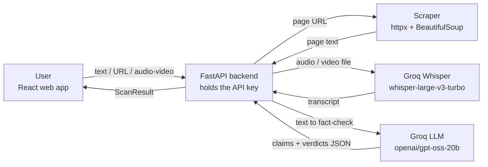

# TruthLens: Architecture Overview

**Status:** DRAFT v0.2 (Sprint 1) · based on the code in this repository

## 1. System context (current)



**Planned (Sprint 2, not built yet):** after the LLM extracts claims, the backend also queries the Google Fact Check Tools API and adds any published fact-checks as evidence.

## 2. Components

| Component | Where | Responsibility |
|---|---|---|
| Web app | `frontend/` | Three input tabs (Text, URL, Media); shows verdict stamps, reasoning and a disclaimer |
| API layer | `backend/main.py`, `backend/routers/scanner.py` | Routes, input checks, error mapping, CORS |
| Rate limiter | `backend/ratelimit.py` | Per-IP request limit to protect the free quota |
| Scraper | `backend/services/scraper.py` | Fetches a page and extracts readable text; refuses non-public addresses |
| Transcription | `backend/services/whisper_service.py` | Sends audio/video to Groq's hosted Whisper |
| Fact-checker | `backend/services/groq_service.py` | Prompts the LLM and validates its JSON against `ScanResult` |
| Models | `backend/models.py` | Request and response schemas |

## 3. Request flows

**Text** `POST /api/scan/text`: validate (1–8000 chars) → LLM fact-check → `ScanResult`.

**URL** `POST /api/scan/url`: validate URL → scraper (public addresses only, max 2MB read, text cut to 8000 chars) → LLM fact-check → `ScanResult`.

**Media** `POST /api/scan/media`: check extension and size (25MB) → Whisper transcript → LLM fact-check → `ScanResult`. Only speech is analyzed. Images and video frames are **not** analyzed.

The LLM receives at most 6000 characters; longer input is truncated and the result says so.

## 4. Result model

```json
{
  "source_summary": "One sentence about what was analyzed",
  "overall_note": "One-line takeaway",
  "claims": [
    { "text": "The claim, stated plainly", "verdict": "true | misleading | false | unverifiable", "reasoning": "1–2 sentences" }
  ]
}
```

There is no numeric score and no source list yet. Both are open decisions (see the feature inventory).

## 5. Behavior when things go wrong

| Situation | Response |
|---|---|
| Invalid input (empty text, bad URL) | 422 |
| Page cannot be fetched, is not HTML, or points to a non-public address | 422 with a readable message |
| Unsupported file type | 415 |
| File over 25MB | 413 |
| Empty file | 400 |
| No speech found in media | 422 |
| Too many requests from one IP | 429 |
| Groq error, missing key, or unusable model output | 502 |

## 6. Security decisions

- The Groq key lives only in `backend/.env` (listed in `.gitignore`). The browser never sees it. Git history was checked and contains no keys.
- CORS allows only the origins in `ALLOWED_ORIGINS` (default: local dev) and does not use credentials.
- URL scanning blocks `localhost`, private networks and cloud metadata addresses on every redirect hop. Limitation: DNS rebinding is not fully prevented, so a hardened deployment should also restrict outbound network access.
- The system prompt tells the model to treat scraped content as data and ignore instructions inside it. This reduces, but does not eliminate, prompt injection.
- Uploads are read in chunks and rejected as soon as they exceed the limit.
- Rate limiting is in memory and per process. It resets on restart.

## 7. Deployment

**Undecided.** The design is being discussed and will be finalized before Sprint 3. The frontend README currently describes Vercel (frontend) and Render (backend) as an assumption. Configuration is environment-based, so the choice does not change the code.

## 8. Known limitations

- Verdicts come from a language model without live web access, so they can be wrong.
- No caching yet; every scan calls Groq.
- No persistent storage: nothing is saved between requests.
- Whisper only handles speech; scanned images, screenshots and silent video are out of reach today.

## 9. Change log

| Version | Change |
|---|---|
| 0.1 | Initial draft from the project plan |
| 0.2 | Rewritten from the actual code (Groq, Whisper, scraper); added security and limitations |
