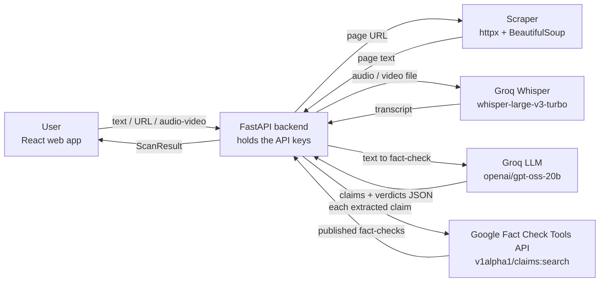

# TruthLens: Architecture Overview

**Status:** DRAFT v0.3 (Sprint 2) · based on the code in this repository

## 1. System context (current)



TruthLens uses a **dual-API pipeline**: Groq extracts up to 6 claims and assigns each verdict, then the backend queries the Google Fact Check Tools API per claim to attach published fact-checks as supporting evidence.

## 2. Components

| Component | Where | Responsibility |
|---|---|---|
| Web app | `frontend/` | Three input tabs (Text, URL, Media); shows verdict stamps, reasoning and a disclaimer |
| API layer | `backend/main.py`, `backend/routers/scanner.py` | Routes, input checks, error mapping, CORS |
| Rate limiter | `backend/ratelimit.py` | Per-IP request limit to protect the free quota |
| Scraper | `backend/services/scraper.py` | Fetches a page and extracts readable text; refuses non-public addresses |
| Transcription | `backend/services/whisper_service.py` | Sends audio/video to Groq's hosted Whisper |
| AI fact-checker | `backend/services/groq_service.py` | Prompts the LLM and validates its JSON against `ScanResult` |
| Fact-check lookup | `backend/services/factcheck_service.py` | Queries Google Fact Check Tools API per claim and attaches published evidence (best-effort) |
| Models | `backend/models.py` | Request and response schemas (`Claim`, `FactCheck`, `ScanResult`) |

## 3. Request flows

**Text** `POST /api/scan/text`: validate (1–8000 chars) → LLM fact-check → Google Fact Check lookup → `ScanResult`.

**URL** `POST /api/scan/url`: validate URL → scraper (public addresses only, max 2MB read, text cut to 8000 chars) → LLM fact-check → Google Fact Check lookup → `ScanResult`.

**Media** `POST /api/scan/media`: check extension and size (25MB) → Whisper transcript → LLM fact-check → Google Fact Check lookup → `ScanResult`. Only speech is analyzed. Images and video frames are **not** analyzed.

The LLM receives at most 6000 characters; longer input is truncated and the result says so. After Groq returns up to 6 claims, `factcheck_service.enrich_scan_result` queries the Google Fact Check Tools API for each claim without modifying Groq's verdicts.

## 4. Result model

```json
{
  "source_summary": "One sentence about what was analyzed",
  "overall_note": "One-line takeaway",
  "fact_check_status": "ok | not_configured | unavailable",
  "claims": [
    {
      "text": "The claim, stated plainly",
      "verdict": "true | misleading | false | unverifiable",
      "reasoning": "1–2 sentences",
      "fact_checks": [
        {
          "publisher": "Publisher name",
          "rating": "Publisher rating",
          "url": "[https://example.com/fact-check](https://example.com/fact-check)",
          "title": "Fact-check article title",
          "review_date": "2024-01-15T00:00:00Z"
        }
      ]
    }
  ]
}
```

Published fact-checks are attached per claim as supporting evidence (empty list when none exist). There is no numeric credibility score yet (see the feature inventory).

## 5. Behavior when things go wrong

| Situation | Response |
|---|---|
| Invalid input (empty text, bad URL) | 422 |
| Page cannot be fetched, is not HTML, or points to a non-public address | 422 with a readable message |
| Unsupported file type | 415 |
| File over 25MB | 413 |
| Empty file | 400 |
| No speech found in media | 422 |
| Too many requests from one IP | 429 |
| Groq error, missing `GROQ_API_KEY`, or unusable model output | 502 |
| Missing `GOOGLE_FACTCHECK_API_KEY` | 200 with Groq results, empty `fact_checks`, and `fact_check_status: "not_configured"` |
| Google Fact Check API timeout, rate limit, or HTTP/network error | 200 with Groq results, empty `fact_checks` on failed claims, and `fact_check_status: "unavailable"` |

## 6. Security decisions

- API keys (`GROQ_API_KEY` and `GOOGLE_FACTCHECK_API_KEY`) live only in `backend/.env` locally (listed in `.gitignore`) or in the hosting platform's secret environment settings in production. They are never hardcoded and the browser never sees them.
- CORS allows only the origins in `ALLOWED_ORIGINS` (default: local dev) and does not use credentials.
- URL scanning blocks `localhost`, private networks and cloud metadata addresses on every redirect hop. Limitation: DNS rebinding is not fully prevented, so a hardened deployment should also restrict outbound network access.
- The system prompt tells the model to treat scraped content as data and ignore instructions inside it. This reduces, but does not eliminate, prompt injection.
- Uploads are read in chunks and rejected as soon as they exceed the limit.
- Rate limiting is in memory and per process. It resets on restart.

## 7. Deployment

**Undecided.** The design is being discussed and will be finalized before Sprint 3. The frontend README currently describes Vercel (frontend) and Render (backend) as an assumption. Configuration is environment-based, so the choice does not change the code.

## 8. Known limitations

- AI verdicts come from a language model without live web access, so they can be wrong; Google Fact Check Tools supplements claims with published reviews when available, but coverage is limited to previously fact-checked claims.
- No caching yet; every scan calls Groq and (when configured) queries the Google Fact Check Tools API per claim.
- No persistent storage: nothing is saved between requests.
- Whisper only handles speech; scanned images, screenshots and silent video are out of reach today.

## 9. Change log

| Version | Change |
|---|---|
| 0.1 | Initial draft from the project plan |
| 0.2 | Rewritten from the actual code (Groq, Whisper, scraper); added security and limitations |
| 0.3 | Added Google Fact Check Tools API integration (dual-API pipeline, updated response schema, and fallback behavior) |