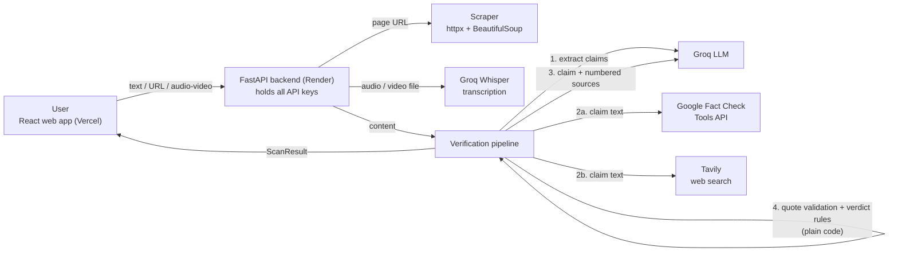

# TruthLens: Architecture Overview

**Status:** v1.0 (Sprint 3) · based on the code in this repository

## 1. System context



## 2. The verification pipeline

The core design rule: **the LLM never has the last word.** It reads sources and quotes them. Plain code decides whether the quotes are real and how far the verdict may go.

| Step | Where | What happens |
|---|---|---|
| 1. Extract | `judge_service.extract_claims` | The LLM lists up to 5 checkable claims. It is told not to judge them |
| 2. Gather | `factcheck_service`, `evidence_service` | Published fact-checks and web search results are fetched in parallel. Failures are contained: the claim just has fewer sources |
| 3. Judge | `judge_service.judge_claim` | The LLM sees the claim and numbered sources (`[S1]`, `[S2]`…). For each relevant source it returns an exact quote and a stance (`supports`, `refutes`, `neutral`) |
| 4. Validate | `judge_service.validate_evidence` | A quote is kept only if it cites a real source id **and** appears word for word in that source (case, spacing and curly quotes are ignored; minimum 12 characters) |
| 5. Decide | `judge_service.decide_verdict` | `true` needs a supporting quote and no refuting one; `false` the reverse; `misleading` needs at least one of either; everything else is `unverifiable` |
| 6. Explain | `judge_service.build_reasoning` | The explanation is generated from the verified quotes. The model's own free text is discarded |

A claim with no sources skips step 3 entirely and is `unverifiable`.

`services/pipeline.py` chains these steps; all three endpoints call `pipeline.verify_content()`.

## 3. Components

| Component | Where | Responsibility |
|---|---|---|
| Web app | `frontend/` | Three input tabs (Text, URL, Media); verdict stamps, verified quote cards with source links, status notices, disclaimer |
| API layer | `backend/main.py`, `backend/routers/scanner.py` | Routes, input checks, error mapping, CORS |
| Pipeline | `backend/services/pipeline.py` | Runs the steps above and builds the final `ScanResult` and `overall_note` |
| Judge | `backend/services/judge_service.py` | Claim extraction, evidence-only judging, quote validation, verdict rules |
| Evidence search | `backend/services/evidence_service.py` | Tavily search; returns text passages per claim |
| Fact-check lookup | `backend/services/factcheck_service.py` | Google Fact Check Tools API |
| Scraper | `backend/services/scraper.py` | Fetches a page and extracts readable text; refuses non-public addresses |
| Transcription | `backend/services/whisper_service.py` | Sends audio/video to Groq's hosted Whisper |
| Rate limiter | `backend/ratelimit.py` | Per-IP request limit to protect free quotas |
| Models | `backend/models.py` | Request, response, `Evidence` and `Passage` schemas |

## 4. Request flows

**Text** `POST /api/scan/text`: validate (1–8000 chars) → pipeline → `ScanResult`.

**URL** `POST /api/scan/url`: validate URL → scraper (public addresses only, max 2MB read, text cut to 8000 chars) → pipeline → `ScanResult`.

**Media** `POST /api/scan/media`: check extension and size (25MB) → Whisper transcript → pipeline → `ScanResult`. Only speech is analyzed. Images and video frames are **not** analyzed.

The pipeline sends at most 6000 characters to the model; longer input is truncated and `overall_note` says so.

## 5. Result model

```json
{
  "source_summary": "One sentence about what was analyzed",
  "overall_note": "Checked 2 claims against sources: 1 false, 1 unverifiable.",
  "fact_check_status": "ok | not_configured | unavailable",
  "evidence_status": "ok | not_configured | unavailable",
  "claims": [
    {
      "text": "The claim, stated plainly",
      "verdict": "true | misleading | false | unverifiable",
      "reasoning": "Generated by code from the verified quotes",
      "evidence": [
        { "url": "...", "title": "...", "quote": "exact text from the source",
          "stance": "supports | refutes | neutral",
          "source_type": "web | fact_check", "retrieved_at": "ISO 8601" }
      ],
      "fact_checks": []
    }
  ]
}
```

There is no numeric score: a single number would suggest precision the system cannot honestly offer. The evidence list is the proof.

## 6. Behavior when things go wrong

| Situation | Response |
|---|---|
| Invalid input (empty text, bad URL) | 422 |
| Page cannot be fetched (for example HTTP 403), is not HTML, or points to a non-public address | 422 with a readable message |
| Unsupported file type | 415 |
| File over 25MB | 413 |
| Empty file | 400 |
| No speech found in media | 422 |
| Too many requests from one IP | 429 |
| Groq error, missing key, or unusable model output | 502 |
| Web search or fact-check lookup fails | 200; affected claims are `unverifiable`; status field says `unavailable` |
| No Tavily key configured | 200; claims are `unverifiable` with a clear reason; `evidence_status` is `not_configured` |
| One claim's judgment fails | 200; that claim is `unverifiable`, the others are unaffected |

## 7. Security decisions

- API keys live only in `backend/.env` locally and in Render's environment in production (`.env` is in `.gitignore`). The browser never sees them. The Tavily key is sent in a request header, and error messages never contain it.
- CORS allows only the origins in `ALLOWED_ORIGINS` (default: local dev) and does not use credentials.
- URL scanning blocks `localhost`, private networks and cloud metadata addresses on every redirect hop. Limitation: DNS rebinding is not fully prevented, so a hardened deployment should also restrict outbound network access.
- Scraped pages and search results are untrusted: both prompts tell the model to treat them as data and ignore instructions inside them. Even if the model were fooled, the code-side rules still cap the verdict by the verified quotes.
- The frontend only makes `http` and `https` source links clickable.
- Uploads are read in chunks and rejected as soon as they exceed the limit.
- Rate limiting is in memory and per process (it resets on restart). Behind Render's proxy the backend must start with `--proxy-headers --forwarded-allow-ips="*"`, otherwise all visitors share one bucket.
- Judging runs a few claims at a time (`JUDGE_CONCURRENCY`, default 3) to stay inside free-tier rate limits.

## 8. Deployment

| Part | Host | Notes |
|---|---|---|
| Frontend | Vercel | `VITE_API_URL` is baked in at build time; redeploy after changing it |
| Backend | Render (free tier) | Sleeps when idle, so the first request can take about a minute. Start command: `uvicorn main:app --host 0.0.0.0 --port $PORT --proxy-headers --forwarded-allow-ips="*"` |

All configuration is environment-based (see the README's Configuration table). The live frontend is <https://truthlens-blush-seven.vercel.app>.

## 9. Known limitations

- Source reliability is not weighted: one refuting quote from a weak source can still produce `false`.
- Search results are short snippets, so some true claims stay `unverifiable`. This is the safe failure direction.
- Some sites block the scraper (HTTP 403). A fallback extraction service is planned.
- Quote checking proves that the quote exists in the source, not that the source is right or that the model read it correctly in context.
- No caching: every scan calls Groq, Tavily and Google. No persistent storage.
- Whisper only handles speech; images, screenshots and silent video are not analyzed, and there is no manipulation detection yet.
- Accuracy has not been measured on a labeled dataset.

## 10. Change log

| Version | Change |
|---|---|
| 0.1 | Initial draft from the project plan |
| 0.2 | Rewritten from the actual code (Groq, Whisper, scraper); added security and limitations |
| 1.0 | Evidence-based pipeline (fact-check lookup, web search, quote-checked judge); deployment decided (Vercel + Render); security notes extended |